# Lab 2.1: C Libraries, Linking, and ELF Executable Structure

## Introduction

I compiled a small C program that reported its process information, then inspected the system headers, C library files, and static and dynamic ELF executables. I used Ubuntu in WSL on x86-64 Linux. The screenshot and raw text output were captured in separate runs, so their process IDs differ; each PID in the description refers to the linked screenshot.

Environment: `gcc (Ubuntu 15.2.0) 15.2.0`; kernel `6.6.87.2-microsoft-standard-WSL2`. I recorded these with `gcc --version` and `uname -r` in [the environment output](outputs/00-environment.txt).

## Theoretical background

A C header and a compiled library have different jobs. A header such as `stdio.h` gives the compiler declarations, types, and macros. It lets the compiler check how a function is called. It does not contain the machine instructions that make `printf` run. Those instructions are in compiled library files. On this system, `libc.so.6` is the shared C library and `libc.a` is its static archive.

The linker resolves references from a program to library code. With static linking, it copies the needed object code from archive files into the executable. The resulting program is larger and can run without loading those library files at runtime. With dynamic linking, the executable keeps references to shared libraries. A dynamic linker loads the required libraries when the program starts, allowing programs to share library code in memory and use library updates without being relinked.

An ELF file stores information that Linux needs to start a program. The ELF header identifies the file format, architecture, type, and entry point. Program headers describe segments that the loader maps into memory, including the requested interpreter and stack permissions. The dynamic section records runtime dependencies such as `libc.so.6`. `readelf -h`, `readelf -l`, and `readelf -d` inspect these separate views without running the executable. `ldd` reports the shared libraries resolved for a dynamic executable; a statically linked executable has no dynamic dependencies to resolve.


## Program source

I saved the listing as `src/procinfo.c`. `getpid()` and `getppid()` supplied the process IDs. `time()` and `localtime()` prepared the current time for `asctime()`. The `printf()` calls printed the labels and values in the sample's order, and the final path line matched the sample format.

```c
#include <stdio.h>
#include <stdlib.h>
#include <unistd.h>
#include <time.h>

int main(void) {
    // Get current process ID
    pid_t my_pid = getpid();
    pid_t my_ppid = getppid();

    // Get current time
    time_t current_time = time(NULL);
    struct tm *time_info = localtime(&current_time);

    // Format and display information
    printf("=== Process Information ===\n");
    printf("My Process ID (PID):  %d\n", my_pid);
    printf("Parent Process ID:    %d\n", my_ppid);
    printf("Current Time:         %s", asctime(time_info));
    printf("Executable Path:      /proc/self/exe\n");

    return 0;
}
```

## Step 1: Compile and run

I compiled `procinfo.c` and ran it to display the process details.

```sh
gcc procinfo.c -o procinfo
./procinfo
```

The screenshot showed PID `2882`, parent PID `2837`, the current time, and `/proc/self/exe`. The separate raw output recorded PID `1950` and parent PID `1932`. The program ran in the foreground as a child of the interactive Bash shell, which printed its prompt again after the program exited. The labels and order matched the brief's sample. [Raw output](outputs/01-program-run.txt)

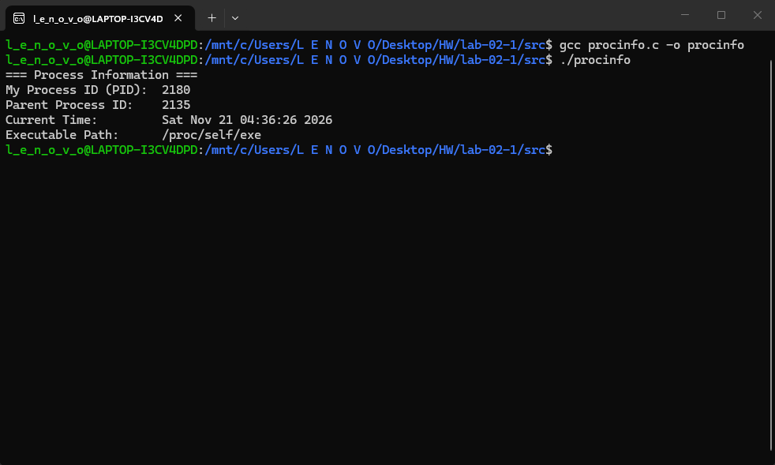

## Step 2: Check the headers

I checked for the standard headers and searched their declarations.

```sh
ls /usr/include/stdio.h /usr/include/unistd.h
grep "printf" /usr/include/stdio.h | head -2
grep "getpid" /usr/include/unistd.h | head -2
```

Both header paths existed. The `getpid` search returned its declaration. The first two `printf` matches included a comment and an `fprintf` declaration because `grep` also matches the `printf` substring in those lines. This showed why a short text search is not the same as reading a complete header. [Raw output](outputs/02-headers.txt)

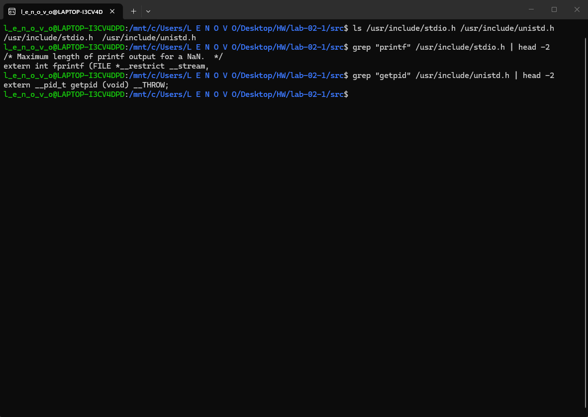

## Step 3: Find the library files

I located the shared library and archive in the requested directories.

```sh
pwd
ls /lib/x86_64-linux-gnu/libc.so*
ls /usr/lib/x86_64-linux-gnu/libc.a
```

The shared-library search listed `libc.so` and `libc.so.6` under `/lib/x86_64-linux-gnu/`. The archive existed at `/usr/lib/x86_64-linux-gnu/libc.a`. [Raw output](outputs/03-library-locations.txt)

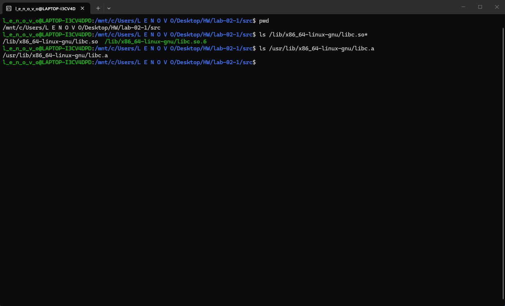

## Step 4: Compare static and dynamic builds

I built static and dynamic executables and compared their sizes.

```sh
gcc -static procinfo.c -o procinfo_static
gcc procinfo.c -o procinfo_dynamic
ls -lh procinfo_dynamic procinfo_static
```

The dynamic executable was `16K`; the static executable was `961K`. The larger static file included the library code needed by this program. [Raw output](outputs/04-linking-comparison.txt)

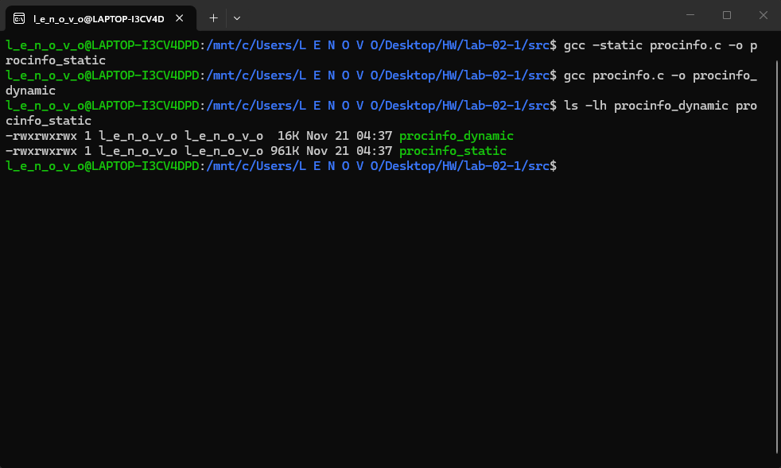

## Step 5: Read the dynamic ELF header

I inspected the dynamic executable's ELF header.

```sh
pwd
readelf -h procinfo_dynamic
```

The file was ELF64, little-endian, and for `Advanced Micro Devices X86-64`, with entry point `0x1140`. Its type was `DYN` (position-independent executable), which identified it as a position-independent executable that used dynamic linking. [Raw output](outputs/05-elf-header-dynamic.txt)

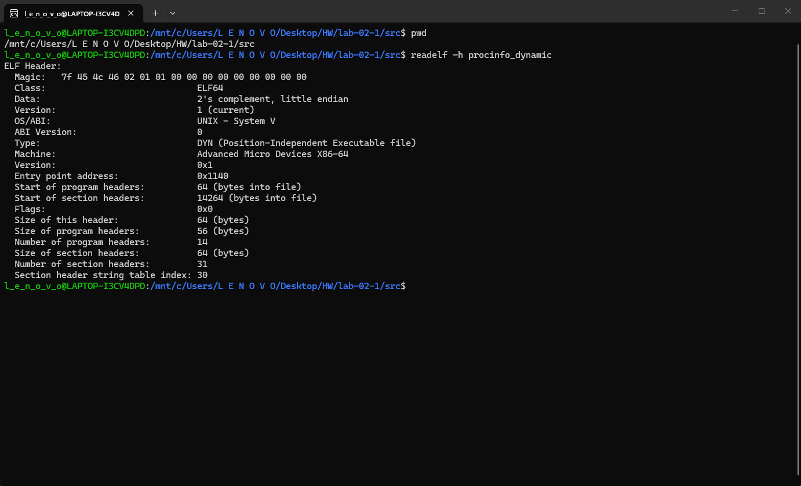

## Step 6: Read the dynamic program headers

I inspected the loadable segments, interpreter, and stack permissions.

```sh
readelf -l procinfo_dynamic
```

The full output was saved in [the program-header log](outputs/06-program-headers-dynamic.txt). For the terminal captures, I used these two views:

```sh
readelf -l procinfo_dynamic | head -24
readelf -l procinfo_dynamic | tail -24
```

I split the terminal evidence across two views so the entries remained readable. `INTERP` named `/lib64/ld-linux-x86-64.so.2`, the dynamic linker that loads the executable's shared libraries before the program starts. The four `LOAD` segments used `R` for read-only data, `R E` for executable code, and `RW` for writable data. `GNU_STACK` had `RW` flags, so the stack was readable and writable but not executable.

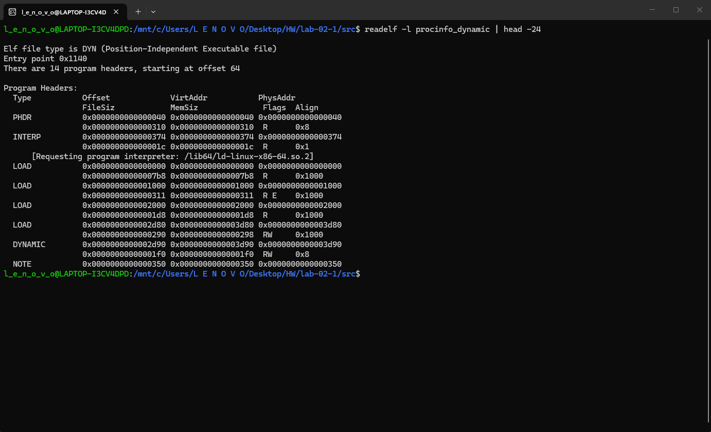

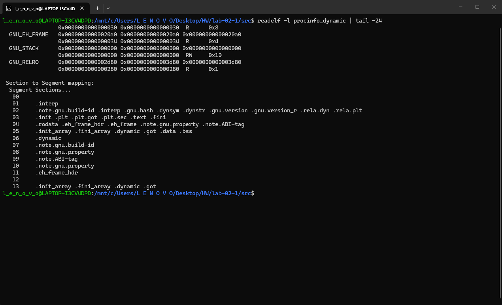

## Step 7: Read the dynamic section

I checked which shared libraries the dynamic executable requested.

```sh
readelf -d procinfo_dynamic
```

The `NEEDED` entry named `libc.so.6`. This tag told the dynamic linker that the executable required that shared library. The dynamic section contained 27 entries. [Raw output](outputs/07-dynamic-section.txt)

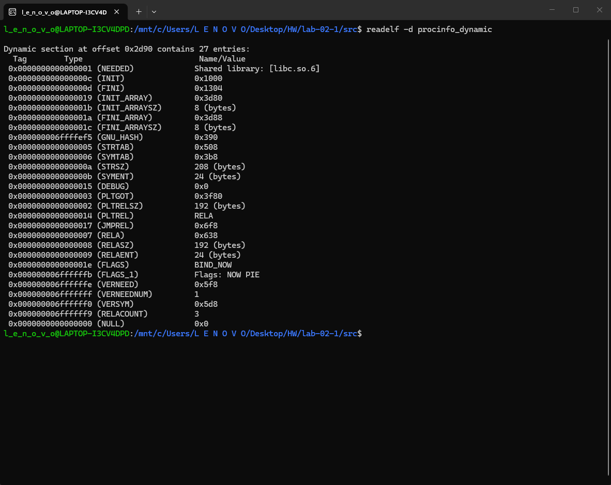

## Step 8: Resolve dynamic dependencies

I used `ldd` to see the shared libraries resolved for the dynamic executable, then checked the `/lib` directory link.

```sh
ldd procinfo_dynamic
ls -ld /lib
```

`libc.so.6` resolved to `/usr/lib/x86_64-linux-gnu/libc.so.6`. `ls -ld /lib` showed `/lib -> usr/lib`, so `/lib` linked to the directory containing the resolved library. The brief's sample used a `/lib/...` path; my output used `/usr/lib/...` because of this directory link. `ldd` also listed `linux-vdso.so.1` and `/lib64/ld-linux-x86-64.so.2`. [Raw output](outputs/08-ldd-dynamic.txt)

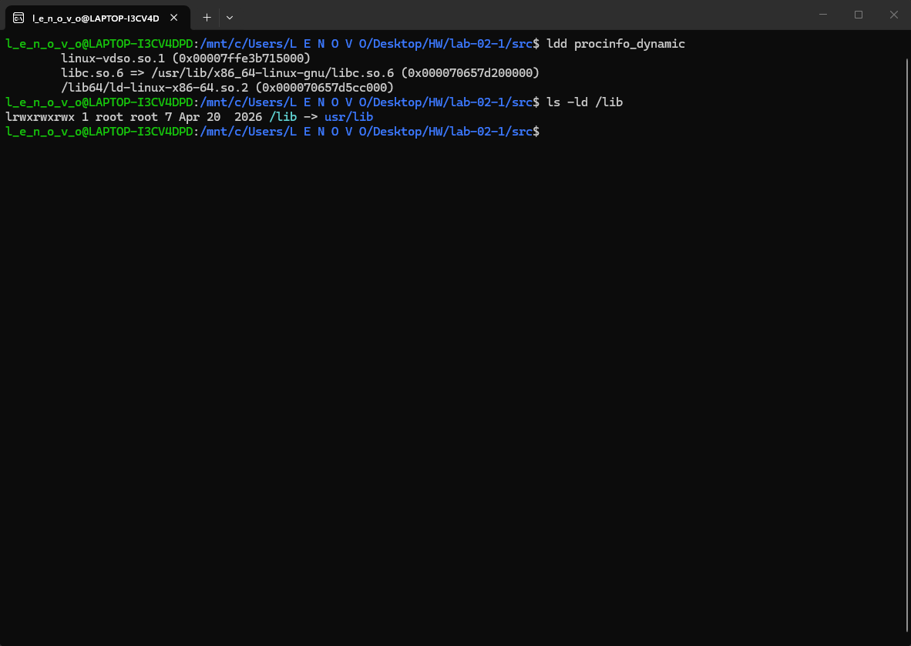

## Step 9: Check the static executable with ldd

I checked whether the static executable had dynamic dependencies.

```sh
pwd
ldd procinfo_static
```

`ldd` printed `not a dynamic executable`, consistent with the static link. [Raw output](outputs/09-ldd-static.txt)

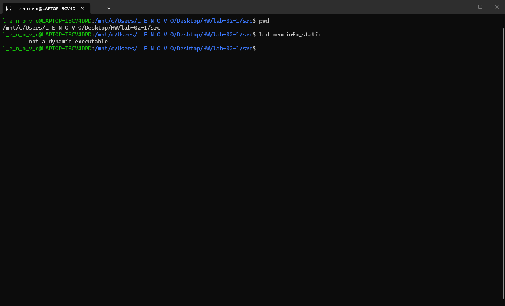

## Step 10: Compare the static ELF metadata

I compared the static file's ELF type, interpreter entry, and dynamic section with the dynamic build.

```sh
readelf -h procinfo_static
readelf -l procinfo_static | grep INTERP
readelf -d procinfo_static
```

The header identified an ELF64 `EXEC` file for `Advanced Micro Devices X86-64`, with entry point `0x401900`. `DYN` identified the dynamically linked position-independent executable; `EXEC` identified this static executable. The `grep INTERP` command printed no matching entry, and `readelf -d` reported that the file had no dynamic section. The static executable included its required library code, so it did not need a dynamic linker or runtime dependency entries. [Raw output](outputs/10-static-comparison.txt)

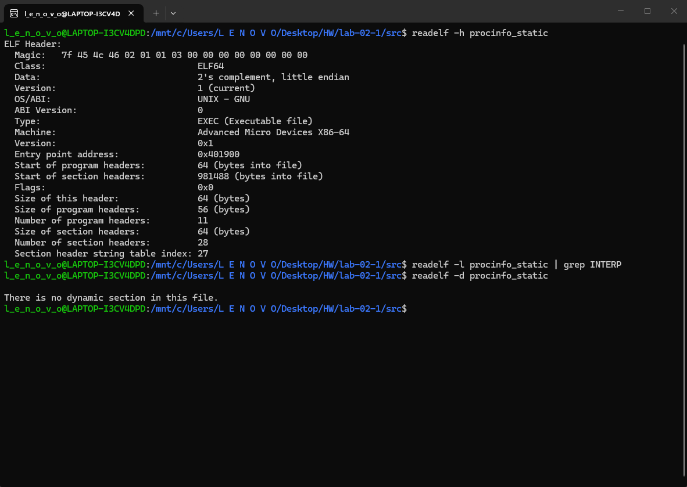

## Knowledge check

### Q1. What is the difference between a C header file and a shared library?

A header provides declarations and definitions that the compiler needs while translating source code. A shared library contains compiled machine code that a dynamic linker loads for a program at runtime.

### Q2. What are static and dynamic linking?

Static linking copies required library object code into the executable, making a larger, self-contained file. Dynamic linking leaves library references in the executable and loads the shared libraries when the program starts.

### Q3. What is an ELF header, and which commands inspect it?

The ELF header identifies an executable's format, class, byte order, type, machine architecture, and entry point. I used `readelf -h procinfo_dynamic` and `readelf -h procinfo_static` to inspect the headers. I used `readelf -l` for program headers and `readelf -d` for dynamic entries.

### Q5. Documentation and GitHub

I documented the commands and observed results in this report and pushed the commits to the repository's GitHub remote.

## Conclusion

I saw how the header declarations and compiled library files served different roles. The two builds also showed the size difference and the ELF metadata behind their runtime behavior. `readelf` exposed the interpreter and `NEEDED` entry in the dynamic file, while the static file had neither a matching interpreter entry nor a dynamic section.
