# Lab 2: Investigating Process Lifecycles and OS Interaction

I compiled and ran five C programs in Ubuntu on WSL. I used the supplied brief and kept the source, command output, and terminal captures in this lab folder.

## Task 1: The long-running process

Aim: I ran a process in the background and checked it before its 30-second loop ended.

In `task1_alive.c`, `printf` wrote the start message, the loop called `sleep(1)` thirty times, and the final `printf` wrote the finish message. `sleep` paused the process between loop iterations while Linux continued to manage it as a process.

I ran these commands in the same Bash session:

```sh
gcc task1_alive.c -o task1
./task1 &
ps aux | grep task1
```

The first capture showed PID 516 running as `./task1`. The `ps` output also included the `grep` command itself. In the later capture, the program printed `I am finished.` and Bash printed `[1]+ Done ./task1` after I pressed Enter.


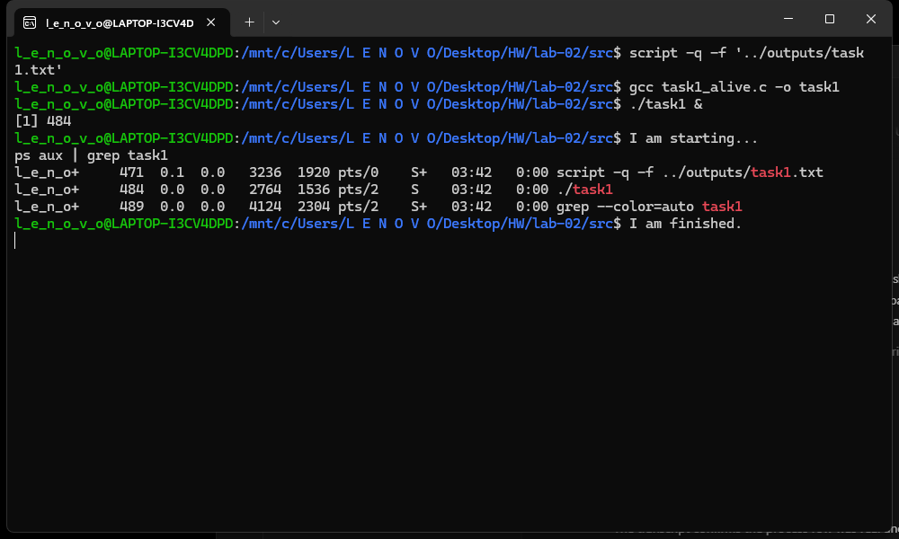

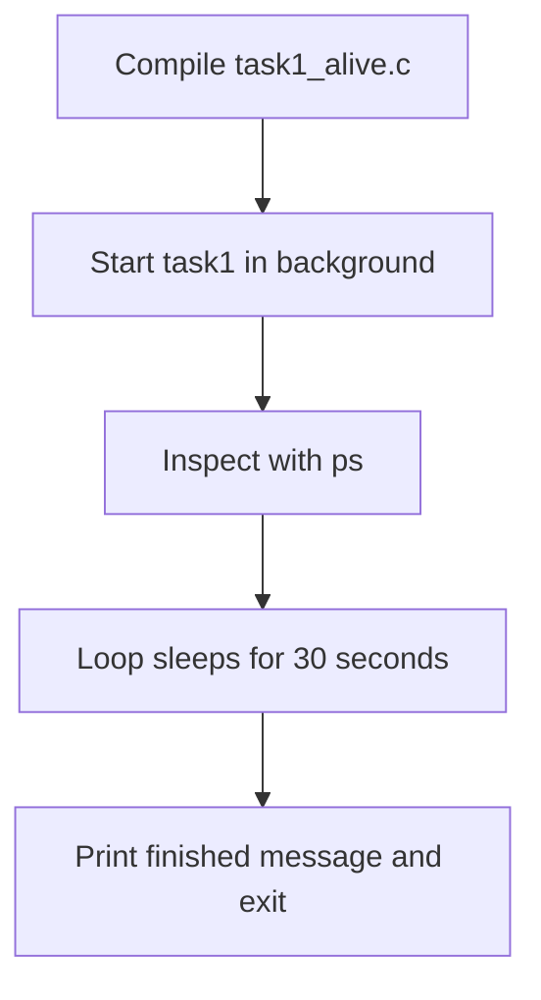

## Task 2: Process identity

Aim: I read the process ID and parent process ID while the program was still running.

In `task2_identity.c`, `getpid()` returned the program's PID and `getppid()` returned its parent's PID. The two `printf` calls displayed those values, and `sleep(20)` kept the process available for inspection. I used `$!` in the `ps` command so Bash supplied the PID of the background job instead of the brief's example value `12345`.

I ran these commands in one Bash session:

```sh
gcc task2_identity.c -o task2
./task2 &
ps -p $! -o pid,ppid,cmd
```

The terminal showed PID 959, PPID 912, and command `./task2`. The PPID belonged to the Bash shell that launched the background job.

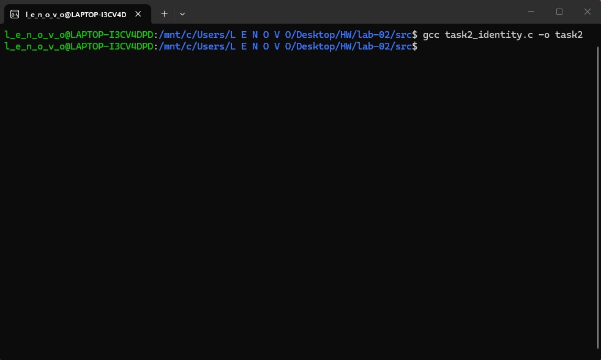

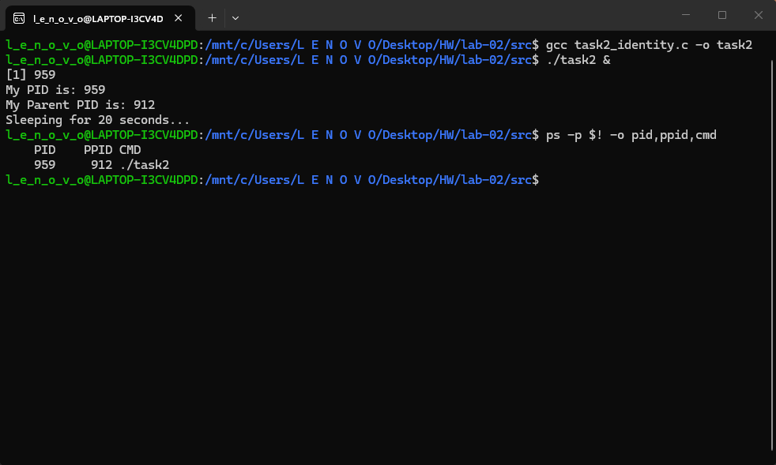

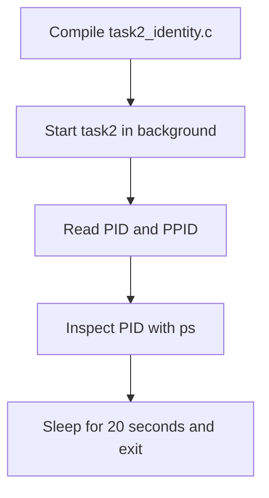

## Task 3: Exit codes and OS feedback

Aim: I checked the shell status after positive and negative input.

In `task3_exit.c`, `scanf` read an integer. A positive value printed `Success` and returned 0; other values printed `Failure` and returned 1. Bash kept the most recent command's return status in `$?`.

I ran the two scenarios in one Bash session:

```sh
gcc task3_exit.c -o task3
./task3
5
echo $?
./task3
-5
echo $?
```

For input `5`, the program printed `Success` and `echo $?` printed `0`. For input `-5`, it printed `Failure` and the shell status was `1`.


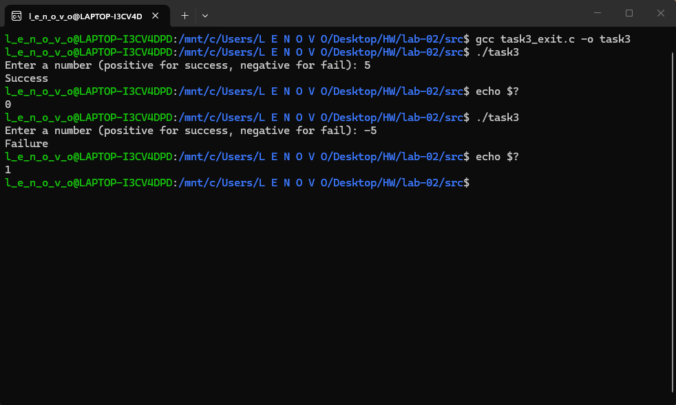

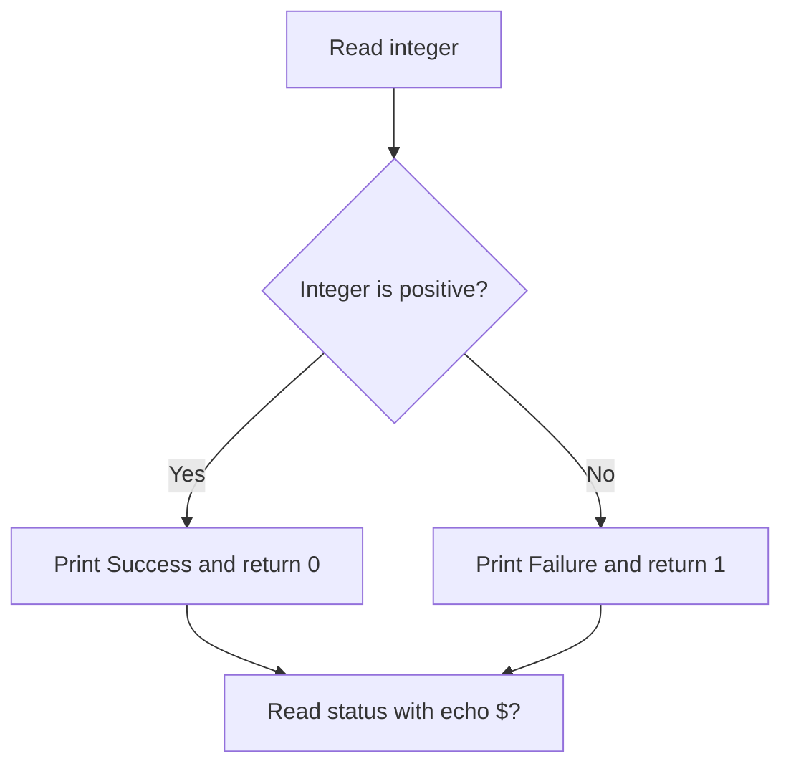

## Task 4: Standard input and output

Aim: I entered a name and read the greeting written by the program.

In `task4_input.c`, `scanf` read the name from standard input into `name`. `printf` wrote the greeting to standard output. I entered `Atip` at the prompt.

I ran:

```sh
gcc task4_input.c -o task4
./task4
Atip
```

The program printed `Hello, Atip! Welcome to OS Class.` after it read the input.

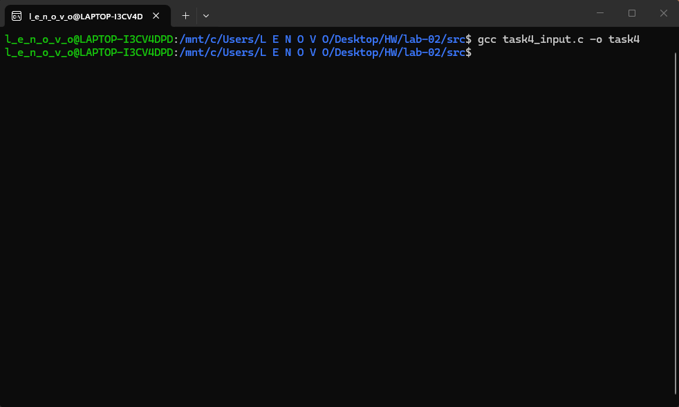

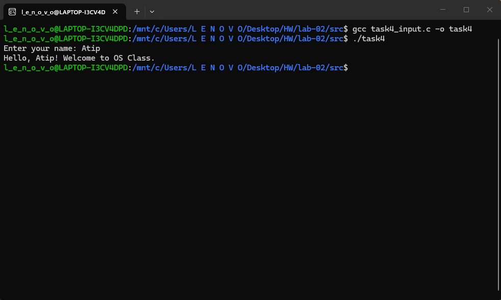

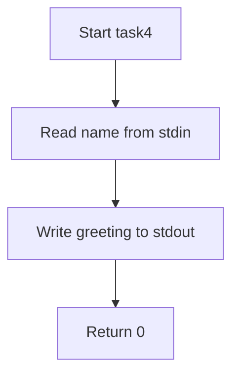

## Task 5: Conditional execution and termination

Aim: I chose both options and checked the status after each run.

In `task5_control.c`, `getpid()` printed the process ID. `scanf` read the choice. Input `1` printed `Continuing...`, waited for five seconds, and returned 0. Other input printed `Exiting...` and returned 1.

I ran both choices in one Bash session:

```sh
gcc task5_control.c -o task5
./task5
1
echo $?
./task5
0
echo $?
```

For input `1`, the terminal showed PID 1273 and status `0` after the five-second wait. For input `0`, it showed PID 1294 and status `1`.


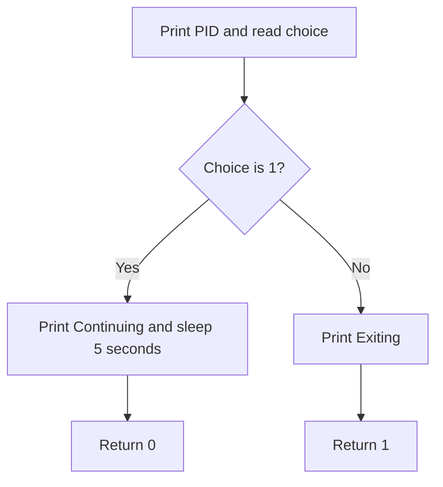

## Conclusion

I observed Linux assign process IDs and parent IDs, keep background jobs available for inspection, and report each program's return value to Bash. I also used `sleep` to keep a process active and used standard input and output to exchange a name with a C program.
