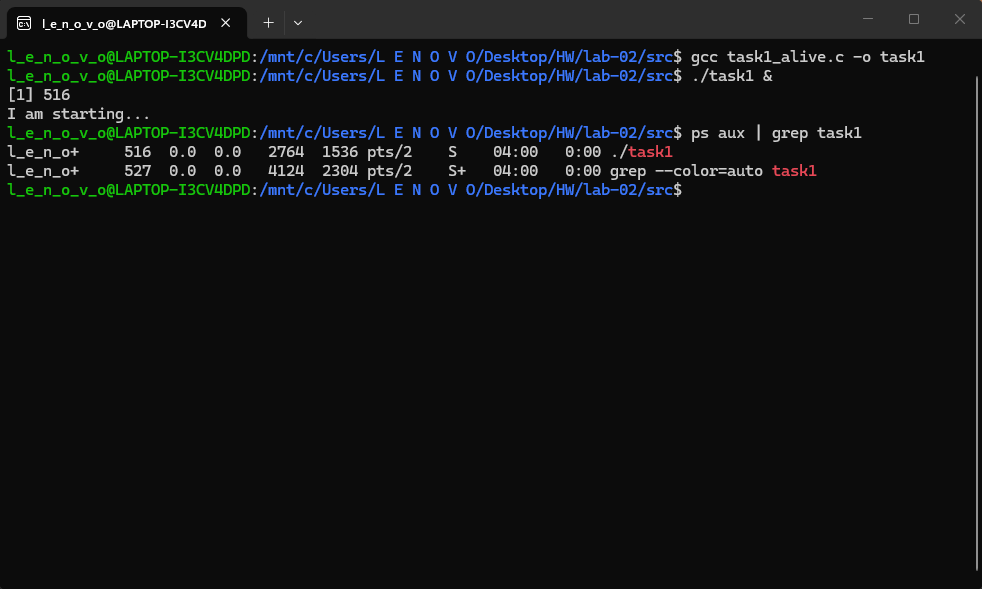
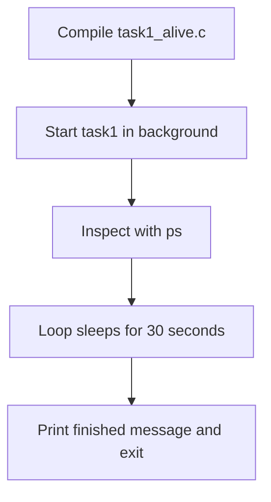
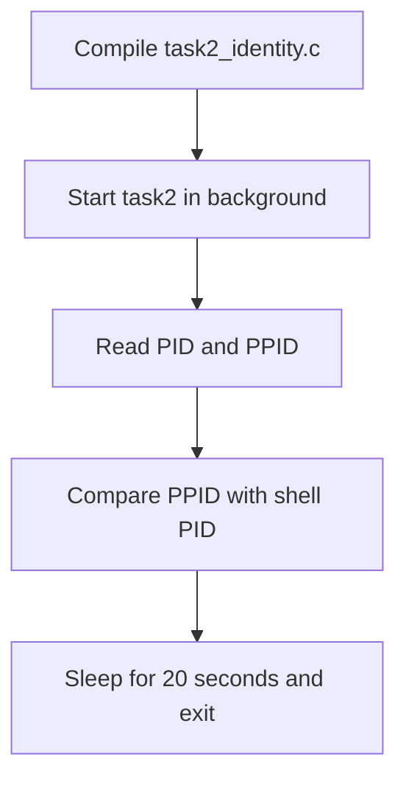
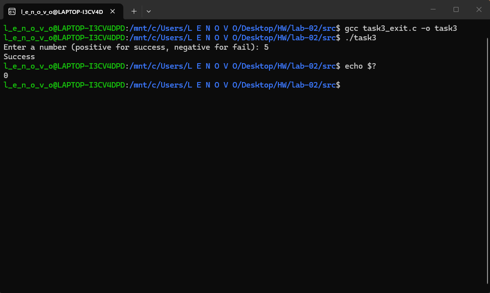
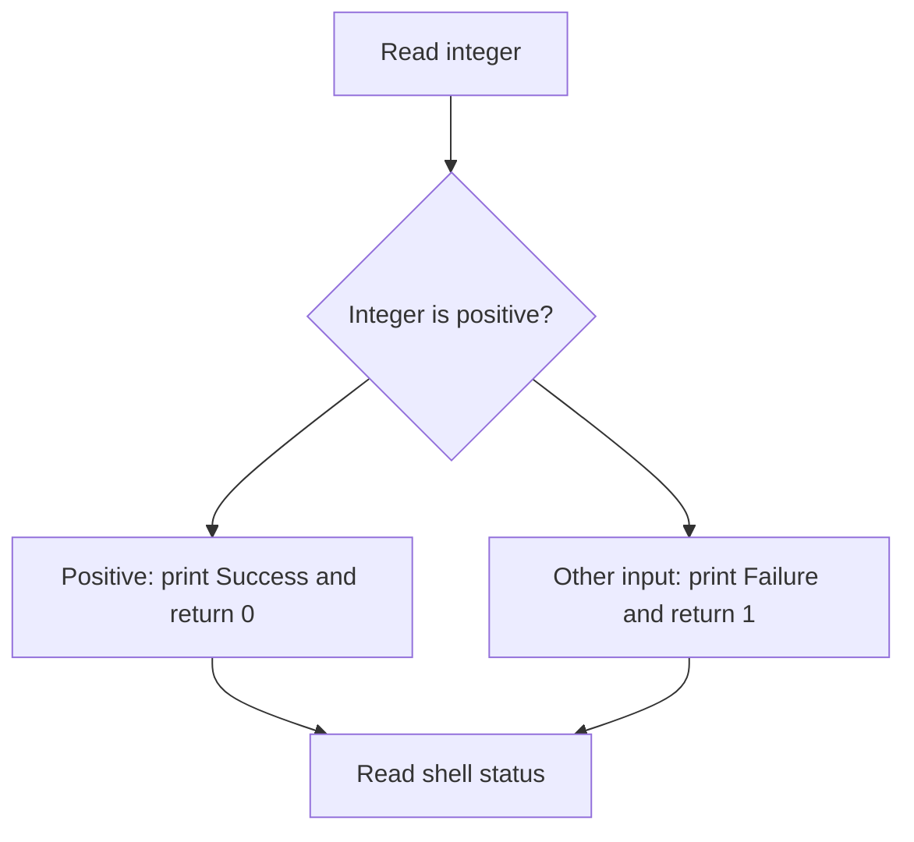
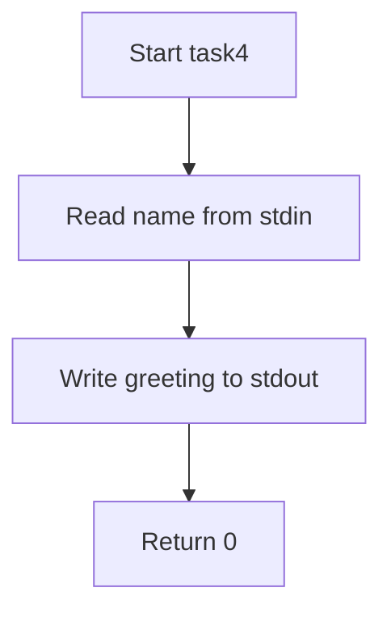
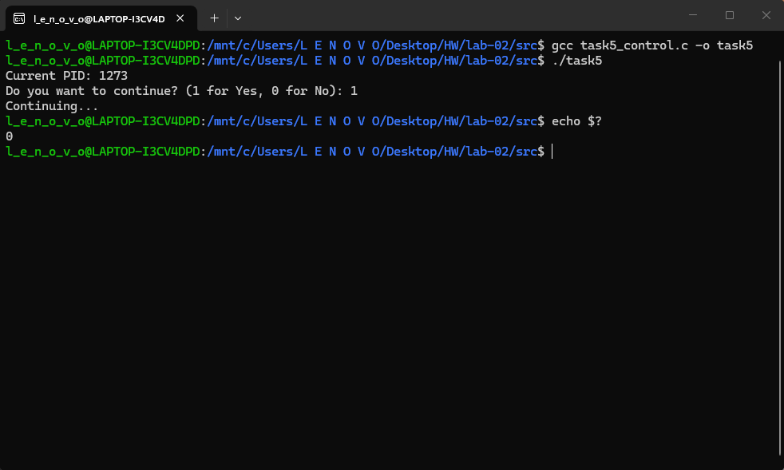
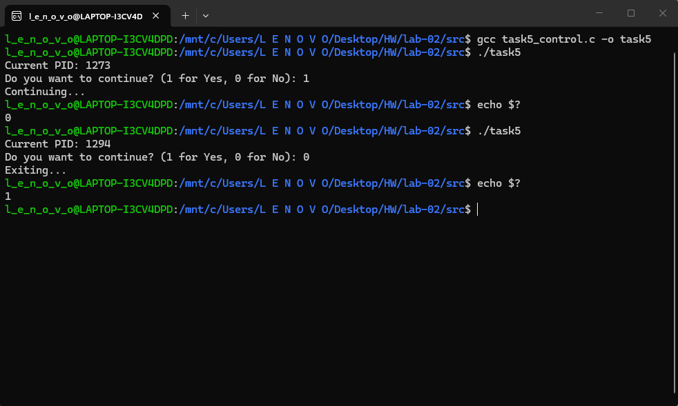
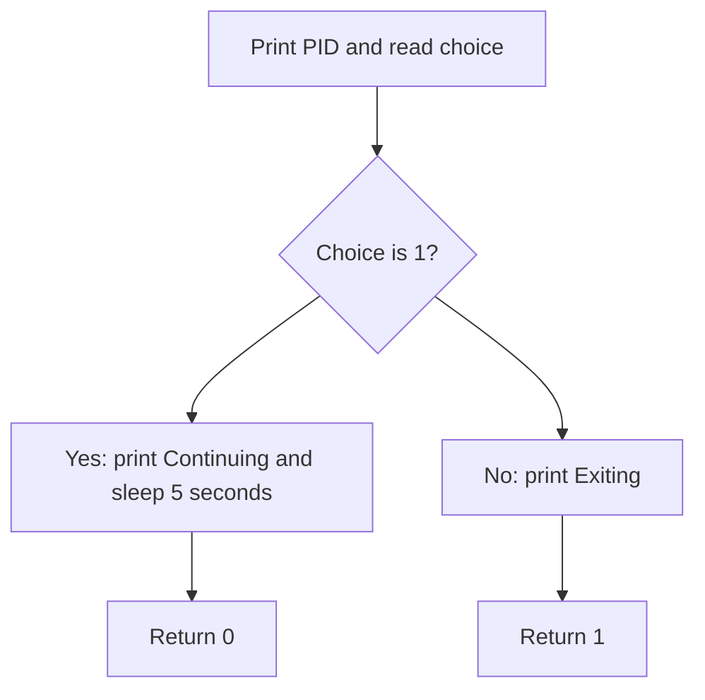

# Lab 2: Investigating Process Lifecycles and OS Interaction

I compiled and ran five C programs in Ubuntu on WSL 2. The environment reported GCC 15.2.0 and kernel `6.6.87.2-microsoft-standard-WSL2`. The terminal screenshots and saved output logs came from separate runs, so process IDs can differ between those records; the values in each description refer to its linked screenshot.

## Theoretical background

A program is a set of instructions stored in a file. When Linux loads it and starts running those instructions, it becomes a process. The operating system tracks each process while it runs and gives it a process ID, or PID. A process can start another process. The process that started it is its parent, and the new process is its child. The child's parent process ID, or PPID, identifies that parent. In these tasks, Bash started each program, so the shell was the parent of the background process.

I added `&` after a command to let Bash start it in the background and return to the prompt. That allowed me to inspect the process while it was still running. The C `sleep` function asked Linux to pause that process for a number of seconds. During the pause, the process remained alive, but it waited instead of using the CPU to do its next step.

When a C program ended, it returned an exit status to the shell. A status of `0` meant the program reported success; a non-zero value meant it reported failure. Bash kept the last command's status in `$?`, so `echo $?` let me read it. Standard input, or stdin, carried text I typed to a program. Standard output, or stdout, carried text the program printed to the terminal. The `getpid()` and `getppid()` functions asked the Linux kernel for the calling process's PID and its parent's PID.

## Task 1: The long-running process

I started the program in the background and checked its process row before it finished.

In `task1_alive.c`, the loop called `sleep(1)` thirty times, then `printf` printed the finished message. The `ps aux` columns I used were `PID` for the process number, `STAT` for its state, `START` for its start time, and `COMMAND` for the command. The screenshot showed PID `516` with `STAT` `S`, which indicated interruptible sleep while the process was inside `sleep()`. `START` showed `04:00`, and `COMMAND` showed `./task1`. The second row appeared because the `grep task1` command itself contained the search text; that grep row had `STAT` `S+`, with `+` marking its process group as foreground for the terminal.

I ran:

```sh
gcc task1_alive.c -o task1
./task1 &
ps aux | grep task1
```



After the loop, the program printed `I am finished.`. I pressed Enter and saw Bash report that the background job was done.




## Task 2: Process identity

I compared the program's parent process ID with the shell PID while the program was running.

In `task2_identity.c`, `getpid()` obtained the program's PID and `getppid()` obtained its parent's PID. The two `printf` calls displayed them, and `sleep(20)` kept the process available for inspection. I used `$!` because Bash assigned the background job a new PID each time, rather than the brief's example `12345`.

I ran these commands in one Bash session:

```sh
gcc task2_identity.c -o task2
./task2 &
ps -p $! -o pid,ppid,cmd
echo $$
```

The screenshot showed PID `1645`, PPID `1599`, and command `./task2`. `echo $$` printed `1599`, so the PPID matched the Bash shell that launched the program. The separate raw log recorded PID `1581` and PPID `1575` in its own run.




## Task 3: Exit codes and OS feedback

I checked the shell status after positive and negative input.

In `task3_exit.c`, `scanf` read an integer. A positive value printed `Success` and returned `0`; another value printed `Failure` and returned `1`. Bash stored each program's return status in `$?`.

I ran both cases in one Bash session:

```sh
gcc task3_exit.c -o task3
./task3
5
echo $?
./task3
-5
echo $?
```

For input `5`, the program printed `Success` and the shell printed `0`. For input `-5`, it printed `Failure` and the shell printed `1`.






## Task 4: Standard input and output

I entered a name and read the greeting printed by the program.

In `task4_input.c`, `scanf` read a name from standard input into `name`. `printf` sent the greeting to standard output. I entered `Atip` at the prompt.

I ran:

```sh
gcc task4_input.c -o task4
./task4
Atip
```

The program printed `Hello, Atip! Welcome to OS Class.` after reading the input.




## Task 5: Conditional execution and termination

I chose both options and checked the status after each run.

In `task5_control.c`, `getpid()` printed the process ID and `scanf` read the choice. Input `1` printed `Continuing...`, waited five seconds, and returned `0`. Other input printed `Exiting...` and returned `1`.

I ran both choices in one Bash session:

```sh
gcc task5_control.c -o task5
./task5
1
echo $?
./task5
0
echo $?
```

For input `1`, the screenshot showed PID `1273` and status `0`. For input `0`, it showed PID `1294` and status `1`. The separate raw log recorded PIDs `1433` and `1435` with the same respective statuses.







## Conclusion

I observed Linux assign process and parent IDs, keep background jobs available for inspection, and pass program return values to Bash. I also used `sleep` to keep a process active and standard input and output to exchange a name with a C program.
