# Lab 3.1: Auditing of Text and Initialized Data Segments via Hardware Disassembly

I compiled the supplied program in Ubuntu on WSL and used GDB to inspect its runtime sections, initialized data, memory mappings and machine instructions. My system used x86-64, so its ELF type and addresses differed from the ARM64 sample in the brief.

Environment: GCC 15.2.0; GDB 17.1; kernel `6.6.87.2-microsoft-standard-WSL2`; architecture `x86_64`.

## Theoretical background

The `.text` section holds machine instructions. The loader maps its pages for reading and execution, but not writing. Constant strings and other read-only values usually go in `.rodata`, which can be read but not executed. Initialized global or static variables go in `.data`, which is readable and writable. Zero-initialized global and static variables go in `.bss`; the executable records the memory size and the loader supplies zeroed memory. These sections are part of a process's virtual address layout. The operating system applies permissions to mapped pages.

The `-g` option adds debugging information so GDB can connect source lines and names to machine instructions. A source breakpoint can resolve to the next executable line if the requested line contains no instruction. Line 22 in this program was a comment, so GDB placed the breakpoint at line 23. A disassembler displays instruction addresses and opcodes. The instruction pointer identifies the next instruction to execute. A multi-byte value's byte order is visible by examining individual bytes at consecutive addresses. Instruction caches hold fetched instructions; data caches serve ordinary reads and writes. Separating code from constants lets the loader apply different page permissions and supports instruction fetch without making code pages writable.

## Section order by address

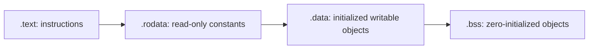

## GDB session flow

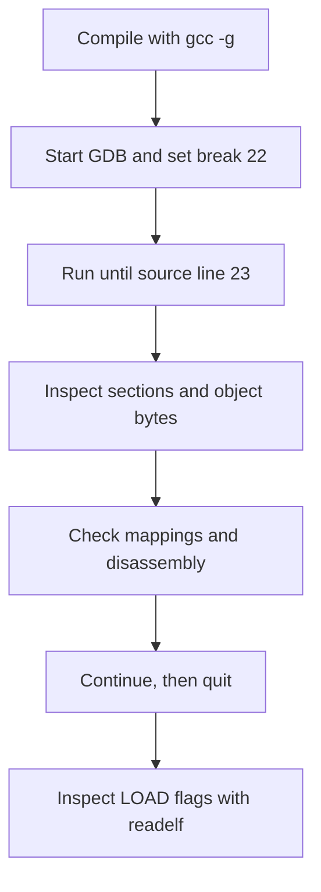

## Task A: Build with debugging symbols

Aim: I compiled the supplied source with debugging symbols.

```sh
gcc -g demo2.c -o demo2
```

The compiler produced no diagnostics. `data_global_var` was initialized to `0x12345678`; `text_string_literal` pointed to a string whose first character was a space. `check_execution` printed from a function in the text section. `main` printed the addresses, called the function, and then reached the breakpoint line.

The listing below shows the statements I inspected. The full source is in [`src/demo2.c`](src/demo2.c).

```c
int data_global_var = 0x12345678;
const char *text_string_literal = " Text_Segment_Verification";

void check_execution() {
    printf("Executing within the text segment instruction block.\n");
}

int main() {
    printf("Addresses:\n");
    printf("Data (Global Initialized): %p\n", (void *)&data_global_var);
    printf("Text String (ROData): %p\n", (void *)text_string_literal);
    printf("Text Code (Function): %p\n", (void *)&check_execution);
    check_execution();
    // Breakpoint here to inspect text and data layers
    printf("Ready for Text/Data segment inspection!\n");
    return 0;
}
```

Raw output: [build log](outputs/01-task-a-build.txt).

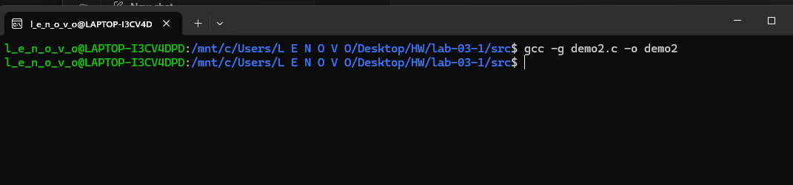

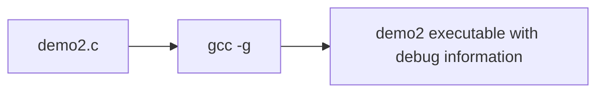

## Task B: Breakpoint and runtime position

Aim: I stopped the program at the requested source line and inspected its runtime addresses.

```sh
gdb ./demo2
```

At the GDB prompt, I entered:

```gdb
break 22
run
```

GDB reported `/usr/lib/x86_64-linux-gnu/libthread_db.so.1`, which identified the x86-64 environment. It set the breakpoint at line 23 because line 22 was a comment. The initialized data address was `0x555555558010`, the string address was `0x555555556008`, and `check_execution` was at `0x555555555169`. The function address was lower than the initialized data address.

Raw output: [GDB session log](outputs/02-debug-session.txt).

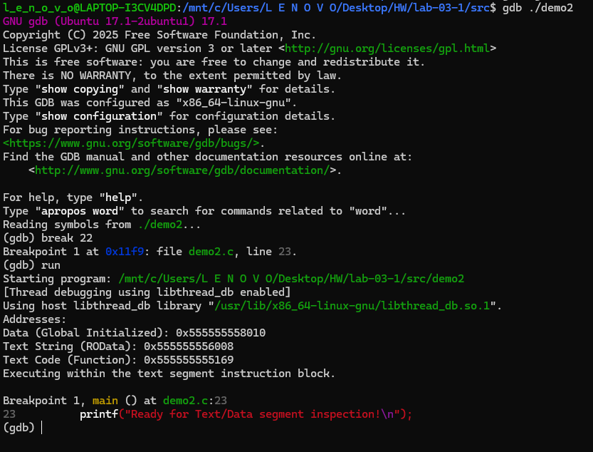


## Task C: Section boundaries

Aim: I read the executable's section map and checked the object addresses against the section ranges.

```gdb
info files
```

GDB reported `elf64-x86-64`. This identifies a 64-bit ELF executable for x86-64. The descriptor does not state byte order; I checked that in Task D. The GDB ranges below use the displayed start and stop addresses. I treated the stop address as the end of each range.

### Deliverable matrix

| Section | Start address | Stop address |
|---|---:|---:|
| `.text` | `0x0000555555555080` | `0x000055555555520f` |
| `.rodata` | `0x0000555555556000` | `0x00005555555560e8` |
| `.data` | `0x0000555555558000` | `0x0000555555558020` |
| `.bss` | `0x0000555555558020` | `0x0000555555558028` |

I checked the boundaries in Bash. `check_execution` at `0x555555555169` was inside `.text`, the string at `0x555555556008` was inside `.rodata`, and `data_global_var` at `0x555555558010` was inside `.data`. The pointer variable itself at `0x555555558018` was also inside `.data`. `.data` occupied the lower range and ended where `.bss` began.

The address differences were `0xe9` for the function from the `.text` start, `0x8` for the string from the `.rodata` start, `0x10` for the integer from the `.data` start, and `0x18` for the pointer from the `.data` start. Bash printed “yes” for all four membership checks and confirmed `.data` preceded `.bss`. The calculations are in [the range-check log](outputs/04-range-checks.txt).

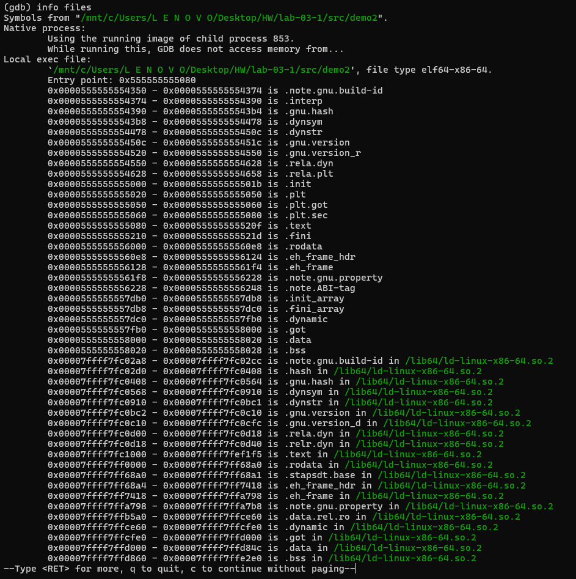

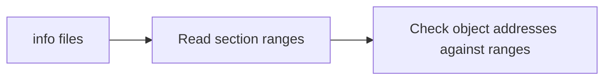

## Task D: Initialized data and byte order

Aim: I examined the integer value, the pointer variable and the string it referenced.

At the GDB prompt, I entered these commands in order:

```gdb
print &data_global_var
x/wx &data_global_var
print text_string_literal
x/s text_string_literal
print &text_string_literal
x/4xb &data_global_var
```

`x/wx` displayed the word as `0x12345678`. `x/4xb` displayed its bytes from the lowest address as `0x78 0x56 0x34 0x12`. The first byte was the least significant byte, so this output showed little-endian byte order. The source value `0x12345678` and the word display had the same numeric value, while the byte display showed the in-memory order.

`text_string_literal` was a pointer stored at `0x555555558018` in `.data`. Its value pointed to the string at `0x555555556008` in `.rodata`; GDB displayed the leading space in `" Text_Segment_Verification"`.

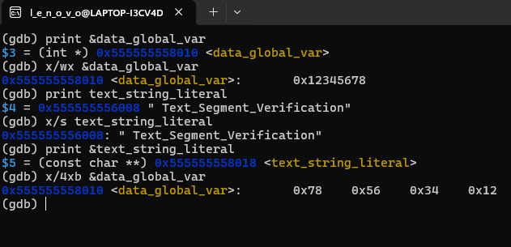

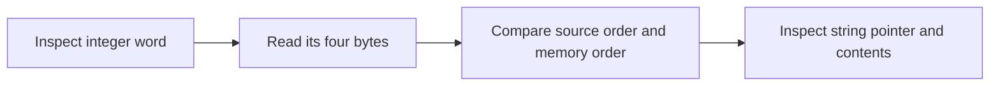

## Verification questions

### Task B

The `libthread_db` path included `x86_64-linux-gnu`, identifying the x86-64 host architecture. GDB printed `data_global_var` at `0x555555558010`. The function address `0x555555555169` was lower than the data address. GDB resolved the breakpoint from line 22 to line 23 because line 22 was a comment and had no executable instruction.

### Task C

`elf64-x86-64` identified a 64-bit ELF file for x86-64; it did not identify byte order. `.text` ranged from `0x0000555555555080` to `0x000055555555520f`, and `check_execution` at `0x555555555169` fell inside it. `.rodata` ranged from `0x0000555555556000` to `0x00005555555560e8`, and the string at `0x555555556008` fell inside it. `.data` ranged from `0x0000555555558000` to `0x0000555555558020`, and `data_global_var` at `0x555555558010` fell inside it. `.data` occupied the lower range; `.bss` began at `0x0000555555558020`.

I checked each membership comparison and its offset in Bash. The function offset was `0xe9`, the string offset was `0x8`, the global offset was `0x10`, and the pointer variable offset was `0x18`. All addresses fell within their respective start-inclusive, stop-exclusive ranges.

### Task D

`x/wx &data_global_var` displayed the word `0x12345678`. `x/4xb &data_global_var` displayed the four individual bytes `0x78 0x56 0x34 0x12`. The variable `text_string_literal` was a pointer stored in `.data` at `0x555555558018`; the string it referenced was in `.rodata` at `0x555555556008`.

### Post-lab questions

The byte order was little-endian because the least significant byte, `0x78`, appeared at the lowest address, followed by `0x56`, `0x34`, and `0x12`.

The mappings showed `.text` pages as readable and executable and `.rodata` pages as read-only and non-executable. `readelf` showed corresponding LOAD permissions. Keeping the sections separate lets the loader allow instruction fetch from `.text` while ordinary data reads access `.rodata`; neither mapping needs write permission. Memory protection operates at page granularity. The processor's instruction cache stores fetched instructions separately from data-cache traffic, which is another reason instruction and data access have distinct roles. I explain these cache roles as theory; I did not measure cache activity.

## Task E: End the debugger session

Aim: I continued the program to normal completion and quit GDB.

```gdb
continue
quit
```

The program printed its final inspection message and exited normally. I then quit GDB and returned to the shell.

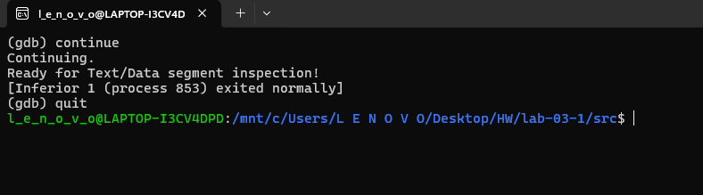

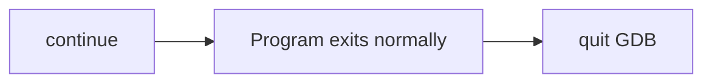

## Additional mapping and instruction checks

I ran `info proc mappings` while the program was stopped. The executable's instruction mapping had `r-xp` permissions, the read-only mapping containing `.rodata` had `r--p`, and the mapping containing `.data` had `rw-p`. `readelf -lW demo2` showed LOAD segments with `R`, `R E`, `R`, and `RW` flags. These outputs showed the different access permissions. Separating instructions and constants allows instruction fetch from code pages while keeping both sections non-writable. Page-level protection prevents writes to read-only pages. The instruction-cache and data-cache explanation above is general system behavior, not a measurement I made.

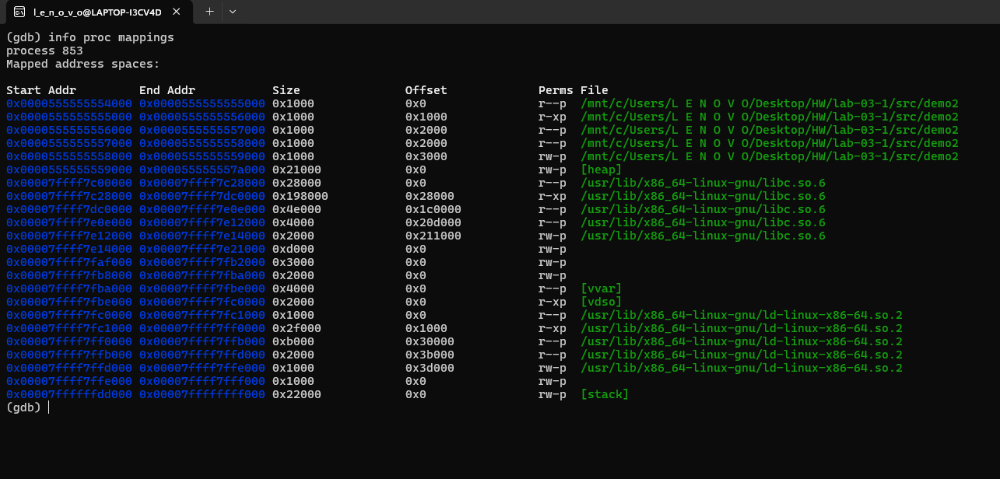

`disassemble check_execution` displayed `endbr64`, `push`, `mov`, `lea`, `mov`, `call`, `nop`, `pop`, and `ret`. The `call` targeted `puts@plt`. The register check showed RIP at `0x5555555551f9`, labelled `<main+118>`.

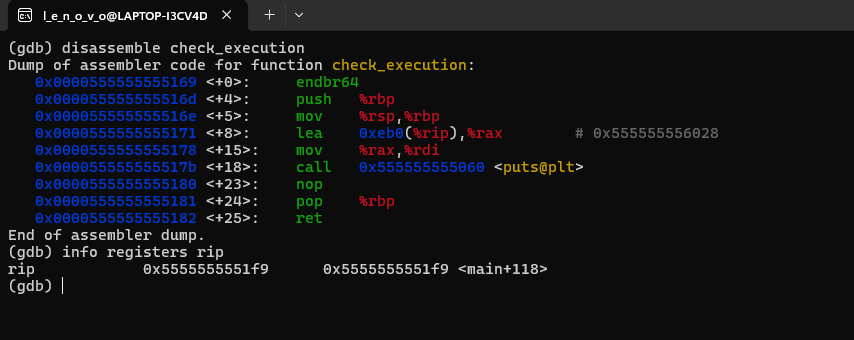

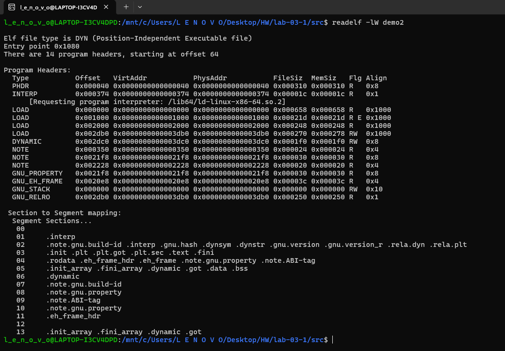

Raw output: [GDB session log](outputs/02-debug-session.txt) and [readelf LOAD log](outputs/03-readelf-loads.txt).

## Conclusion

I compiled the program and used GDB and `readelf` to inspect the executable's section ranges, initialized data, byte order, mappings, instructions and LOAD permissions. The observed byte sequence showed that this x86-64 run used little-endian order.
