# Lab 3.2: Mapping process memory with GDB

## Introduction

I compiled Listing 1 with debugging symbols and used GDB to inspect the program's BSS, stack, and heap addresses. The source left the global variable uninitialized, initialized a local integer to 42, and allocated an integer on the heap with the value 99.

## Task A — Build with debugging symbols

Aim: I compiled `demo.c` with debug information so GDB could resolve source lines and variables.

The source declared `bss_global_var` at file scope, created `stack_local_var` in `main`, and allocated `heap_ptr` with `malloc`. It printed the three addresses before reaching the inspection message. The comment is on line 23, and the `printf` is on line 24.

I ran `gcc -g demo.c -o demo` from `src/`. The command is recorded in [01-build.txt](outputs/01-build.txt). I ran `./demo`; the captured run printed BSS address `0x61853aa26014`, stack address `0x7ffffd9107ec`, and heap address `0x61853aa21010`, then printed `Ready for GDB inspection!`.

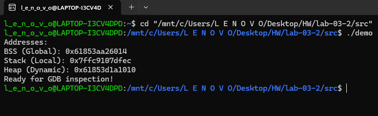

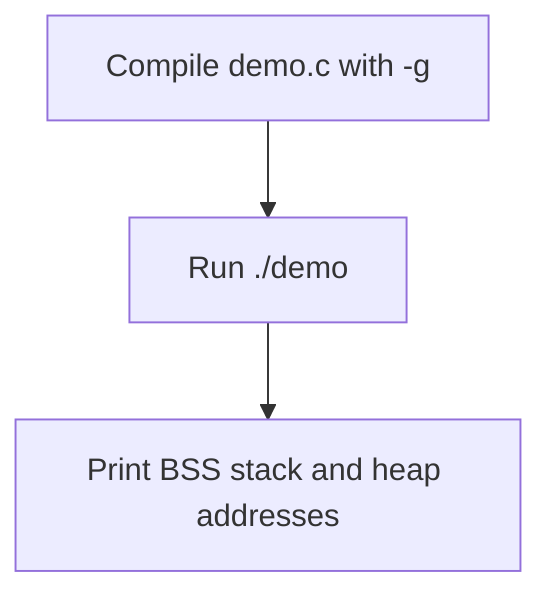

## Task B — Set the breakpoint

Aim: I stopped the process while the allocated values were still live.

I ran `gdb ./demo`, then entered `break 23` and `run`. GDB resolved the requested breakpoint to `demo.c:24`, on `printf("Ready for GDB inspection!\n");`. Line 23 contains the breakpoint comment; the next executable source statement is line 24. The process printed BSS `0x555555558014`, stack `0x7fffffffdb8c`, and heap `0x555555559010` before stopping.

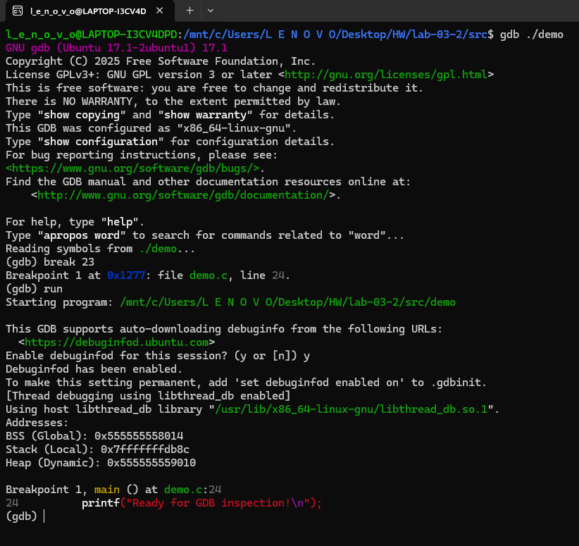

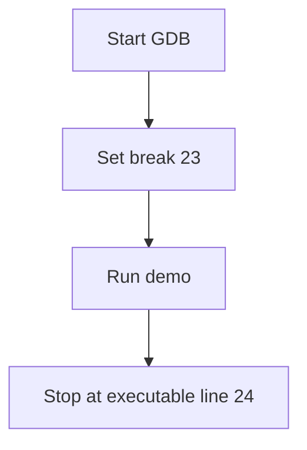

## Task C — Inspect the BSS section and ELF load segment

Aim: I compared the global's address with the section and load-segment information.

I used `info files`. The visible `.bss` section ran from `0x0000555555558010` to `0x0000555555558018`; `.data` ran from `0x0000555555558000` to `0x0000555555558010`. The printed global address `0x555555558014` fell inside `.bss`. The pager prompt appeared after the relevant rows, with `.text`, `.rodata`, `.data`, and `.bss` visible.

I also ran `readelf -lW demo`. The RW `LOAD` had file size `0x278` and memory size `0x280`, a difference of `0x8` bytes. Its section mapping included `.data` and `.bss`, consistent with the eight-byte `.bss` section range shown by GDB.

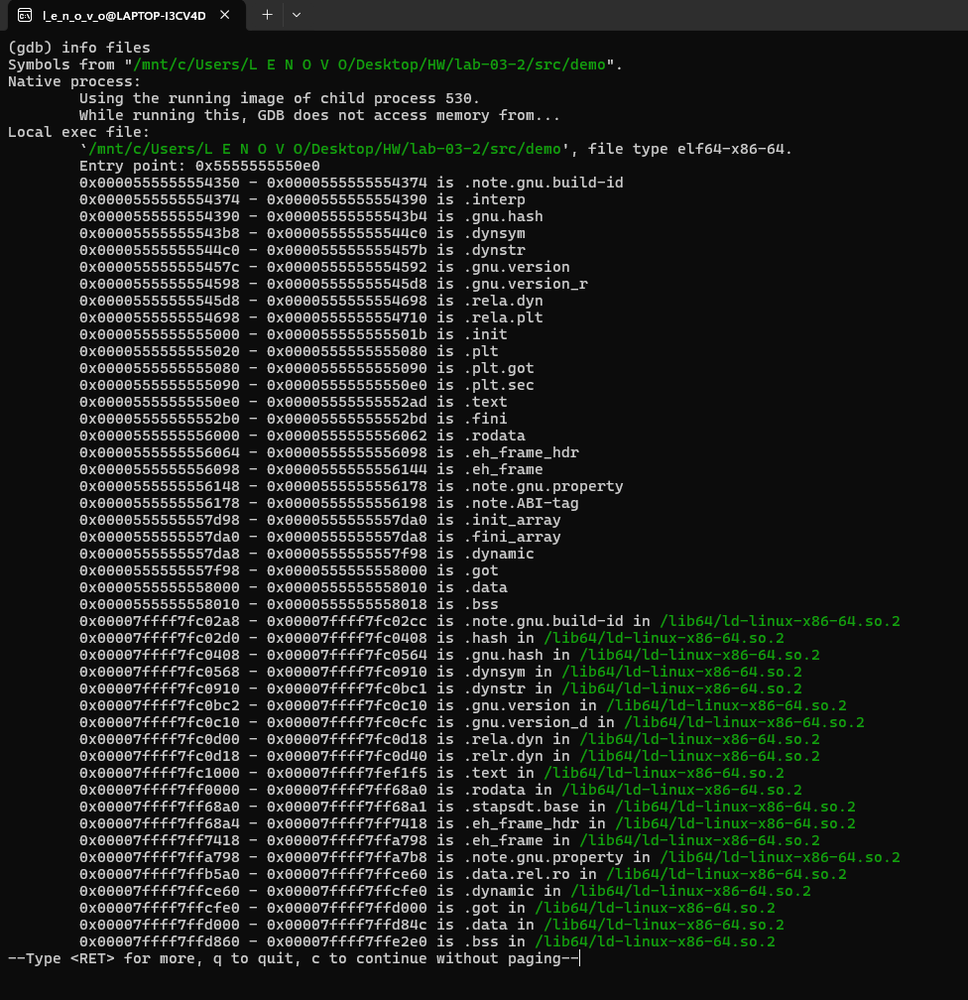

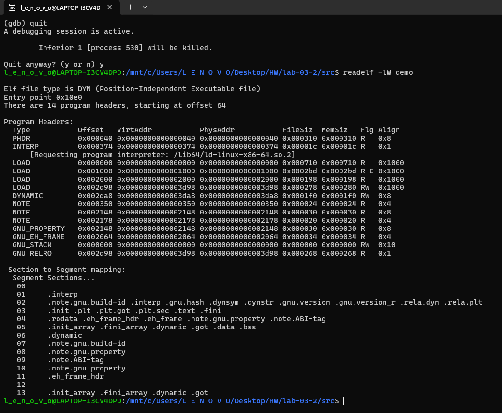

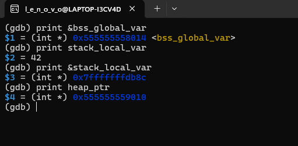

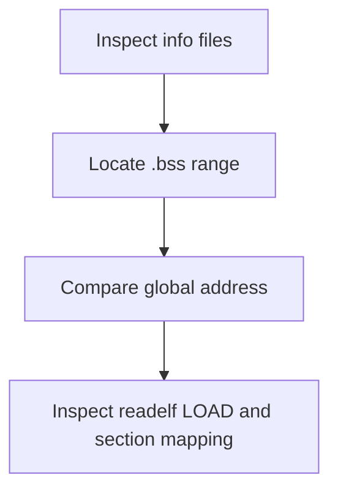

## Task D — Inspect process mappings

Aim: I recorded the live heap and stack mapping limits.

I ran `info proc mappings`. The `[heap]` mapping ran from `0x0000555555559000` to `0x000055555557a000`, and `[stack]` ran from `0x00007ffffffde000` to `0x00007ffffffff000`. The `heap_ptr` value, `0x555555559010`, was inside the heap mapping; the local variable address, `0x7fffffffdb8c`, was inside the stack mapping.

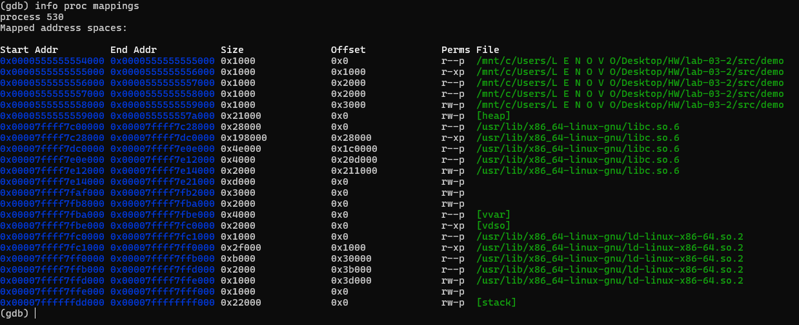

### Recorded range matrix

The stop values below are the exclusive end addresses shown by GDB or ELF section output.

| Region | Start address | Stop address | Evidence |
| --- | --- | --- | --- |
| `.bss` | `0x0000555555558010` | `0x0000555555558018` | `info files` |
| `[heap]` | `0x0000555555559000` | `0x000055555557a000` | `info proc mappings` |
| `[stack]` | `0x00007ffffffde000` | `0x00007ffffffff000` | `info proc mappings` |

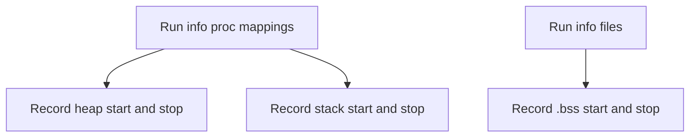

## Task E — Inspect local state and memory

Aim: I read the local variable, its address, the stack pointer contents, and the allocated heap value.

The GDB commands were `info locals`, `print stack_local_var`, `print &stack_local_var`, `print heap_ptr`, `x/4wx $sp`, and `x/1wd heap_ptr`. `info locals` showed `stack_local_var = 42` and `heap_ptr = 0x555555559010`. The separate print commands showed the global address `0x555555558014`, local value `42`, local address `0x7fffffffdb8c`, and heap pointer `0x555555559010`.

The screenshot of `x/4wx $sp` showed `$sp` at `0x7fffffffdb80` and four displayed words: `0x00000000`, `0x00000000`, `0x00000000`, and `0x0000002a`. In `x/1wd heap_ptr`, the output was `0x555555559010: 99`.

In `x/1wd`, `x` asks GDB to examine memory, `1` requests one unit, `w` selects a word (four bytes), and `d` displays the value as a signed decimal integer. Thus GDB read one four-byte word from the heap pointer and displayed its value as decimal `99`.

I entered `continue`; the program printed `Ready for GDB inspection!` and the inferior exited normally. I then entered `quit`.

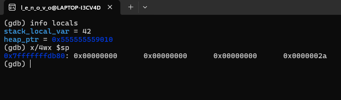

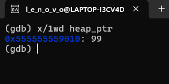


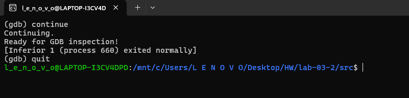

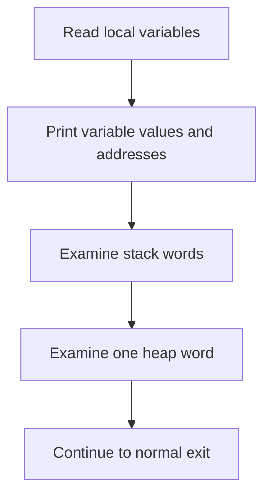

## Post-lab questions

### 1. How did the stack and heap move toward each other?

In the captured mapping, the heap ended at `0x000055555557a000` and the stack began at `0x00007ffffffde000`. The address gap was:

```text
0x00007ffffffde000 - 0x000055555557a000 = 0x00002aaaaaa64000
```

The observed heap value `0x555555559010` was `0x10` bytes above the heap start `0x555555559000`. The local variable at `0x7fffffffdb8c` was `0xc` (12) bytes above `$sp = 0x7fffffffdb80`. These address offsets locate the observed objects within their respective regions. During expansion, the heap generally grows toward higher addresses and the stack toward lower addresses, so both consume the gap between their mapped ranges. This single mapping shows the boundaries and gap; it does not capture multiple expansion cycles.

### 2. Would two running instances show the same addresses?

The OS gives each process its own virtual address space. Two instances can use the same numerical virtual address for their respective variables while those addresses map to different physical memory. The plain `./demo` screenshot showed BSS `0x61853aa26014`, stack `0x7ffffd9107ec`, and heap `0x61853aa21010`. The two captured GDB breakpoint sessions both showed BSS `0x555555558014`, stack `0x7fffffffdb8c`, and heap `0x555555559010`. The differing plain-run and GDB addresses are consistent with address randomization; the GDB captures repeat the same addresses in these sessions. The screenshots did not show two simultaneous instances, so I treated the two-instance result as an explanation of virtual-memory isolation rather than a measured comparison.

## Conclusion

I located the global in the `.bss` section, the local on the stack, and the allocated integer in the heap. GDB showed the expected values `42` and `99`, and `readelf` placed `.bss` in the writable load segment. The screenshots and corresponding text transcriptions are in `screenshots/` and `outputs/shots/`.
