# Lab 3: Data Types and OS Memory Management

I compiled and ran the listings and exercises in Ubuntu on WSL 2. The brief calls the two exercises Lab 1 and Lab 2; I labelled them Exercise 1 and Exercise 2 in this folder.

Environment: GCC 15.2.0; kernel `6.6.87.2-microsoft-standard-WSL2` on x86-64 WSL2.

## Theoretical background

A C data type acts as a contract: it determines how many bytes an object uses and how the program interprets those bytes. The size is not identical on every machine because the compiler follows the target architecture's data model. On 64-bit Linux, LP64 uses 32-bit `int` and 64-bit `long` and pointers. The 64-bit column in the brief's table follows those sizes.

Linux gives a process its own virtual address space. The text segment holds instructions, data holds initialized global and static objects, and BSS holds zero-initialized or uninitialized global and static objects. The heap is used for dynamic allocations and usually grows toward higher addresses. The stack holds function calls and automatic local objects and usually grows toward lower addresses. These are virtual addresses; the operating system maps virtual pages to physical memory and keeps processes isolated. The compiler and ABI set object sizes and alignment rules, while the operating system creates mappings and access permissions when it loads a process. Segment names describe the program's view of memory rather than separate physical chips.

With a position-independent executable (PIE), Linux can load the program at different virtual addresses. Address space layout randomization (ASLR) also varies locations such as the stack and heap between runs. A pointer is itself an object: in Exercise 2 the local pointer variable was on the stack, while the address stored in it referred to allocated memory on the heap. The two addresses therefore described different objects and different parts of the process address space.

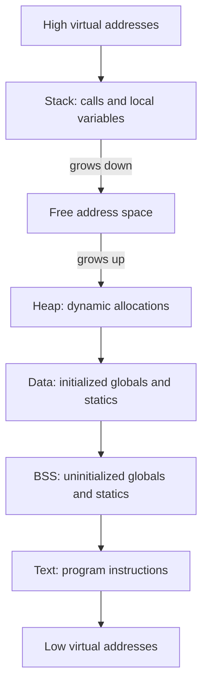

## Listing 1: Data type sizes

Aim: I ran the first listing to see the byte sizes it printed on this system.

In `listing1_sizes.c`, each `sizeof` expression supplied a byte count to `%zu`. I kept the data types and order from the listing.

```sh
gcc listing1_sizes.c -o listing1_sizes
./listing1_sizes
```

The output showed `char` as 1 byte, `int` as 4, `float` as 4, `double` as 8, `long` as 8, and a pointer as 8.

Raw output: [listing 1 log](outputs/01-listing1.txt).

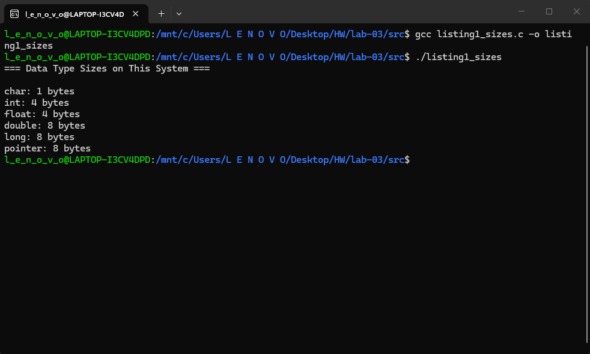


## Listing 2: Variable addresses

Aim: I ran the second listing to print the addresses of its global, local, static and allocated variables.

`global_var` had an initial value and `bss_var` had none. `main` declared the local and static local variables, then `malloc` allocated an integer for `heap_var`. The `%p` calls printed their addresses, and `free` released the allocation.

```sh
gcc listing2_addresses.c -o listing2_addresses
./listing2_addresses
```

The screenshot labelled the automatic local and pointer variable as stack objects, the allocated integer as heap data, and the global and static objects as Data/BSS. The address values were runtime-specific.

Raw output: [listing 2 log](outputs/02-listing2.txt).

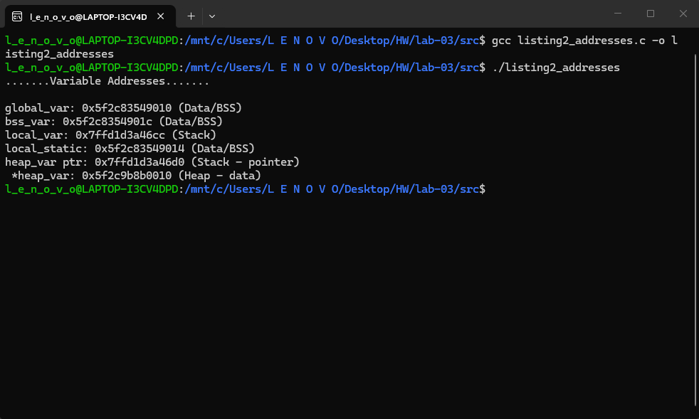

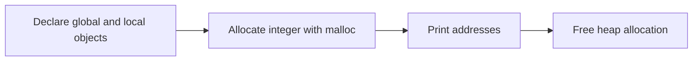

## Listing 3: Pointer and heap memory

Aim: I ran the third listing to compare a pointer's address with the address it stored.

`forheap` was a local pointer. `malloc` returned the address of heap memory, and `*forheap = 30` stored a value there. The two `%p` calls printed the pointer object's stack address and the allocated object's heap address.

```sh
gcc listing3_pointer.c -o listing3_pointer
./listing3_pointer
```

The output showed two different addresses and printed the stored value `30`.

Raw output: [listing 3 log](outputs/03-listing3.txt).

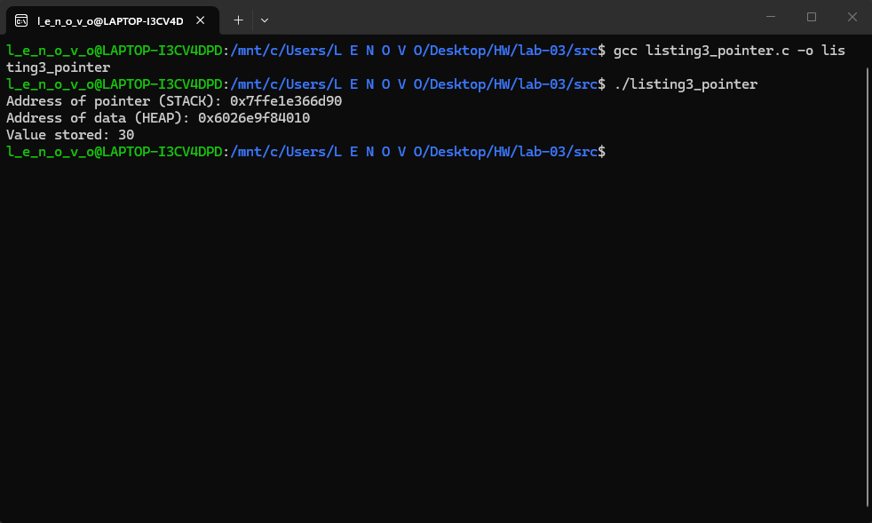

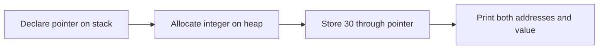

## Exercise 1: Data type sizes

Aim: I measured the requested data type sizes and compared them with the 64-bit column in Table I.

The program printed `sizeof` for the types in the exercise and added `short` and a pointer for the other Table I rows. `%zu` displayed the result as an unsigned size value.

I compiled the source with warnings enabled and then ran it:

```sh
gcc -Wall -Wextra exercise1_sizes.c -o exercise1_sizes
./exercise1_sizes
```

The compile produced no diagnostics. The output matched the 64-bit values in Table I:

| Data type | Table I, 64-bit | Observed |
|---|---:|---:|
| `char` | 1 byte | 1 byte |
| `short` | 2 bytes | 2 bytes |
| `int` | 4 bytes | 4 bytes |
| `float` | 4 bytes | 4 bytes |
| `double` | 8 bytes | 8 bytes |
| `long` | 8 bytes | 8 bytes |
| `unsigned int` | Not listed | 4 bytes |
| `long long` | 8 bytes | 8 bytes |
| pointer | 8 bytes | 8 bytes |

Raw output: [compile log](outputs/04-exercise1-compile.txt) and [program output](outputs/05-exercise1-output.txt).

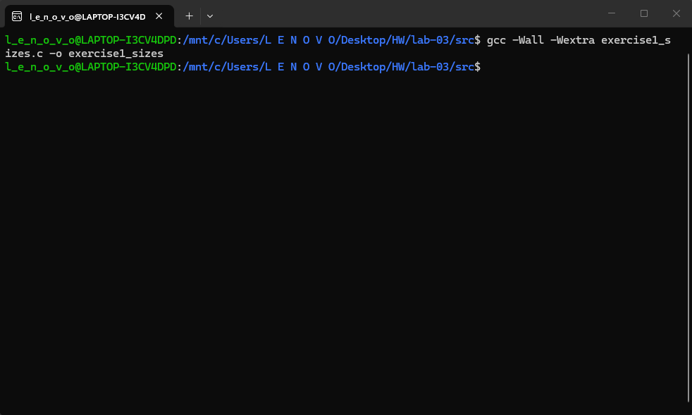

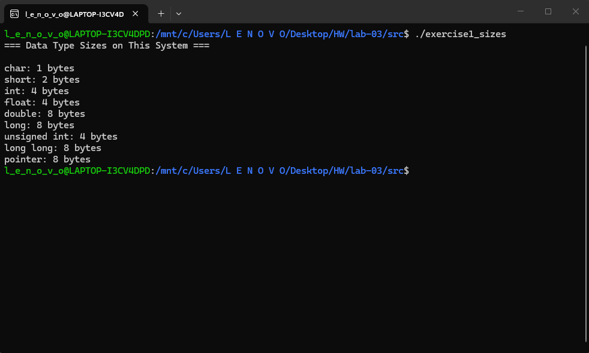

`long` can be 4 bytes on a 32-bit system and 8 bytes on a 64-bit system because the platform's data model defines its width. I only measured the supplied 64-bit WSL system and did not run a 32-bit build.


## Exercise 2: Memory segment address mapping

Aim: I printed addresses for objects in the data, BSS, stack and heap, then compared the stack and heap addresses.

The program declared initialized and uninitialized globals, a local variable, a static local and a heap allocation. It printed the address and segment label for each. `heap_var` was a stack pointer whose value addressed the heap object. The `uintptr_t` values let the program compare addresses and calculate their absolute difference; the `PRIxPTR` and `PRIuPTR` format macros printed it in hexadecimal and decimal.

I compiled and ran the PIE program twice in one shell session:

```sh
gcc -Wall -Wextra exercise2_segments.c -o exercise2_segments
./exercise2_segments
./exercise2_segments
```

From the first output in screenshot 07, `heap_var` was the highest printed address, in the Stack segment, at `0x7ffe3e0c66d8`. `global_initialized` was the lowest, in Data, at `0x57159e870010`. The stack local was `0x7ffe3e0c66d4`, and the allocated heap object was `0x5715b0de4010`. Their absolute difference was `0x28e88d2e26c4`, or `44,979,266,135,748` bytes. I checked that decimal result in Bash from those printed addresses with `echo $((0x7ffe3e0c66d4 - 0x5715b0de4010))`.

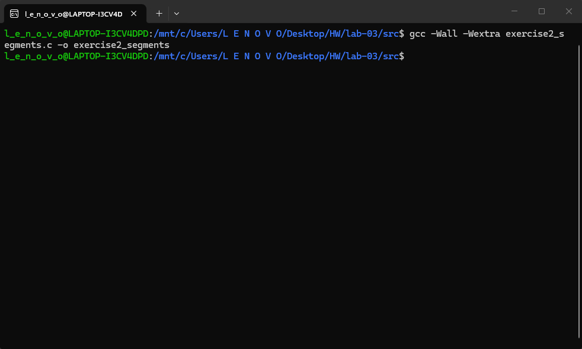

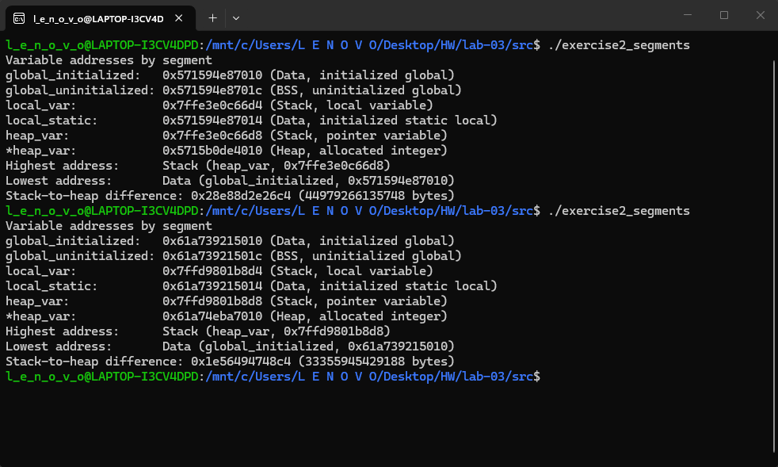

I also built and ran the non-PIE executable, then inspected the PIE file's sections and symbols:

```sh
gcc -no-pie exercise2_segments.c -o exercise2_segments_nopie
./exercise2_segments_nopie
size exercise2_segments
nm exercise2_segments | grep -E "global_initialized|global_uninitialized|local_static"
```

The two PIE runs showed different data, heap and stack addresses, consistent with address randomization. In the non-PIE run, the initialized global was at `0x404040` and the uninitialized global at `0x40404c`, matching the brief's low `0x404...` observation. In the symbol output, `global_initialized` had type `D`, `global_uninitialized` had type `B`, and `local_static` had type `d`; these letters located the objects in initialized data and BSS.

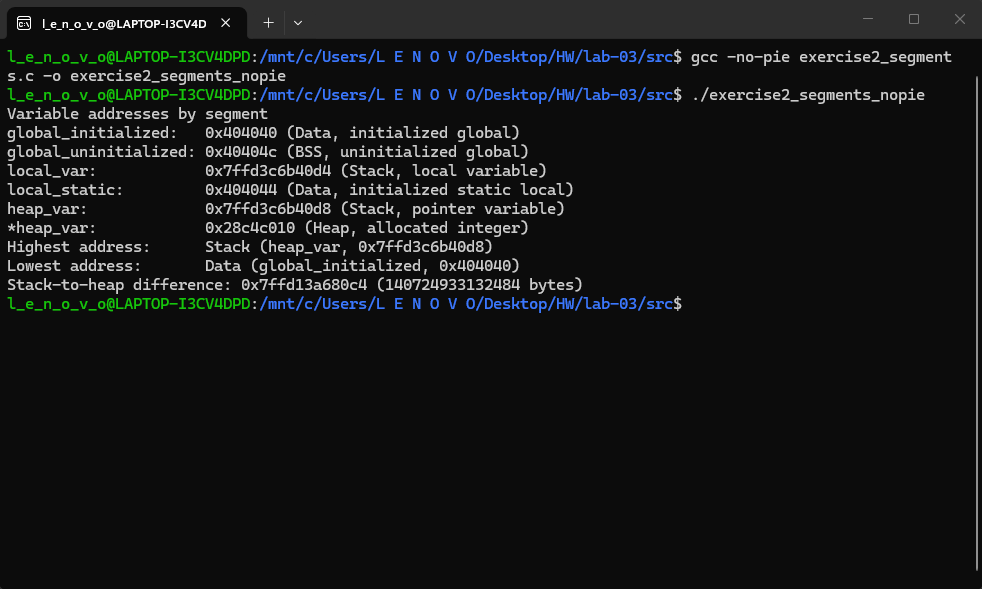

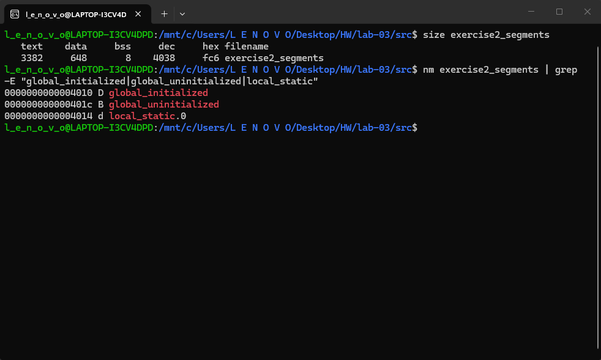

Raw output: [compile log](outputs/06-exercise2-compile.txt), [two PIE runs](outputs/07-exercise2-output.txt), [non-PIE run](outputs/08-exercise2-nopie.txt), [size and symbol inspection](outputs/09-exercise2-symbols.txt), and [Bash arithmetic check](outputs/10-arithmetic-check.txt).

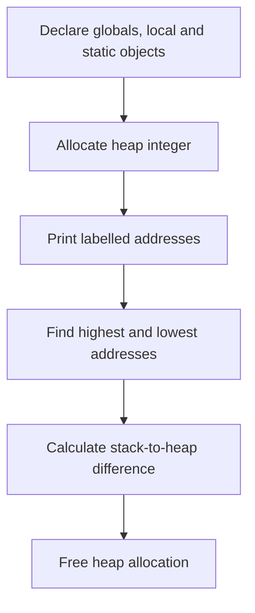

## Conclusion

I observed that the measured sizes matched the 64-bit table values on this WSL system. The address output placed the stack above the heap and data, while the repeated PIE and non-PIE runs showed how executable layout affected the data addresses.
